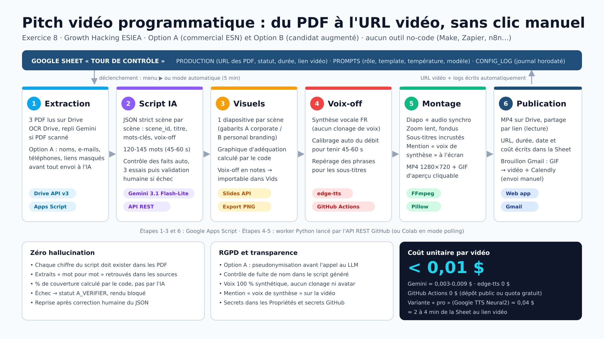

# Pitch vidéo programmatique — Exercice 8 (Growth Hacking, ESIEA)

Une ligne dans une Google Sheet (3 PDF + l'option A ou B) produit, sans aucun clic intermédiaire, une **vidéo de 45 à 60 s sous-titrée et hébergée sur Drive**. Son URL est écrite automatiquement dans la Sheet et un brouillon Gmail est préparé. Aucun outil no-code (Make, Zapier, n8n…) : uniquement Google Apps Script, Python et des API REST.

## Architecture

| # | Étape | Où | Comment |
|---|---|---|---|
| 1 | Extraction PDF | Apps Script | Conversion Drive en Google Docs (OCR intégré, gère les scans), repli Gemini multimodal. **Option A : pseudonymisation** (noms, e-mails, téléphones, liens) avant tout appel à l'IA |
| 2 | Script IA | Apps Script → Gemini (REST) | JSON strict scène par scène (`scene_id`, `titre_ecran`, `mots_cles_ecran`, `texte_voix_off`), 120 à 145 mots. Contrôle automatique des faits, puis jusqu'à 3 essais avec auto-correction |
| 3 | Visuels | Apps Script → Slides API | Une diapositive par scène (gabarits A corporate / B personal branding), graphique d'adéquation, export PNG. La voix-off est placée dans les notes, donc la présentation est importable telle quelle dans Google Vids |
| 4 | Voix-off | Worker Python (GitHub Actions, déclenché par l'API REST depuis la Sheet) | edge-tts (voix neuronale de synthèse FR), débit recalibré pour tenir dans 45-60 s |
| 5 | Montage | Worker Python | FFmpeg : zoom lent, fondus, sous-titres synchronisés par phrase, mention « voix de synthèse », normalisation sonore, GIF d'aperçu |
| 6 | Publication | Web app Apps Script | MP4 sur Drive partagé par lien, URL + durée + date + coût dans PRODUCTION, journal dans CONFIG_LOG, brouillon Gmail (GIF cliquable vers la vidéo et lien Calendly) |

Onglets imposés : **PRODUCTION** (les 9 colonnes du sujet, plus des colonnes de traçabilité à droite), **PROMPTS** (`SCRIPT_A`, `SCRIPT_B` : rôle, template, température, modèle) et **CONFIG_LOG**. Le worker peut aussi tourner dans Colab en mode *polling* (`colab/worker_colab.ipynb`) si l'on ne veut pas utiliser GitHub.

## Installation (résumé, détail dans [INSTALLATION.md](INSTALLATION.md))

1. Nouvelle Google Sheet › Extensions › Apps Script : copier `apps-script/*.gs` et `appsscript.json`. Menu 🎬 › **Initialiser**, puis **Configurer** (clé Gemini…).
2. Déployer › Nouveau déploiement › Application Web (exécuter en tant que moi, accès « Tout le monde »).
3. Pousser ce dépôt sur GitHub. Créer les secrets `WEBAPP_URL` et `WORKER_TOKEN` (menu 🎬 › 🔑), puis renseigner `GITHUB_REPO` et un jeton fine-grained (Actions : écriture) dans 🎬 › Configurer.
4. Déposer `samples/` sur Drive, 🎬 › **Importer les exemples**, sélectionner les lignes, puis ▶.

## Coût unitaire par vidéo

| Poste | Hypothèse | Coût |
|---|---|---|
| Gemini 3.1 Flash-Lite (payant : 0,25 $/M tokens en entrée, 1,50 $/M en sortie) | ~3 000 tokens en entrée et ~1 300 en sortie par essai, de 1 à 3 essais | **0,003 à 0,009 $** |
| Synthèse vocale edge-tts | ~900 caractères | 0 $ (variante Google TTS Neural2 à 16 $/M caractères : ~0,014 $) |
| GitHub Actions (Linux, ~3 min) | gratuit en dépôt public, 2 000 min/mois en privé | 0 $ (au-delà : 0,008 $/min, soit ~0,024 $) |
| Apps Script, Drive, Slides, Gmail | quotas gratuits | 0 $ |
| **Total** | | **< 0,01 $** (variante « tout payant » : ~0,04 $) |

Le coût LLM réel de chaque exécution est calculé à partir des tokens renvoyés par l'API et écrit dans la colonne `Cout_Estime_USD`.

## Analyse des risques

**Hallucinations.** Le LLM n'est jamais cru sur parole. (1) Chaque chiffre du script doit figurer dans les PDF. (2) Chaque scène factuelle cite des extraits mot pour mot, que le code retrouve dans les sources. (3) Le taux de couverture affiché est calculé par le code à partir des seules preuves vérifiées ; « 100 % » est refusé sinon. En cas d'échec après 3 essais, la ligne passe en `A_VERIFIER` et le rendu est bloqué : un humain corrige `Script_JSON`, puis lance « Reprendre ». Limite : une reformulation fausse sans chiffre peut passer, d'où la relecture du brouillon avant tout envoi.

**RGPD.** Option A : pseudonymisation locale avant l'appel au LLM, contrôle de fuite de nom dans le script et minimisation (les valeurs masquées ne sont jamais journalisées). Les données ne doivent passer que par le **palier payant de Gemini** : sur le palier gratuit, Google peut les utiliser pour améliorer ses produits. Une voix de synthèse sans clonage, aucun avatar, et la mention « voix de synthèse » à l'écran (transparence, AI Act art. 50). Les vidéos sont partagées par lien non indexé et supprimables dans le dossier Drive du job. Les journaux d'un dépôt GitHub public sont publics : le worker n'y écrit ni texte ni donnée personnelle (préférer un dépôt privé avec des données réelles).

**Sécurité.** Aucun secret dans le code : Propriétés du script et secrets GitHub. Clé Gemini passée en en-tête HTTP. La web app exige un jeton comparé en temps constant et valide les ID par regex. Le workflow passe `job_id` par variable d'environnement (pas d'injection shell) et a des permissions minimales.

**Dépendances.** edge-tts utilise un service Microsoft non officiel, sans garantie de service (la voix suivante est essayée en cas d'échec ; Google Cloud TTS est le remplacement en production). Google Vids n'a pas d'API publique, d'où le rendu FFmpeg, mais la présentation reste importable dans Vids.

## Tests

`node --test tests/run.test.js` couvre 12 tests : anonymisation, contrôle des faits, chiffres inventés, fuite de nom, calibrage, prompts, et mise en page des diapositives hors zone de sous-titres. `python3 -m unittest tests/test_worker.py` lance 4 tests : sous-titres et calibrage du débit. Un test de bout en bout est aussi fourni : `tests/mock_webapp.py` + `render.py --poll --once --tts mock`.
